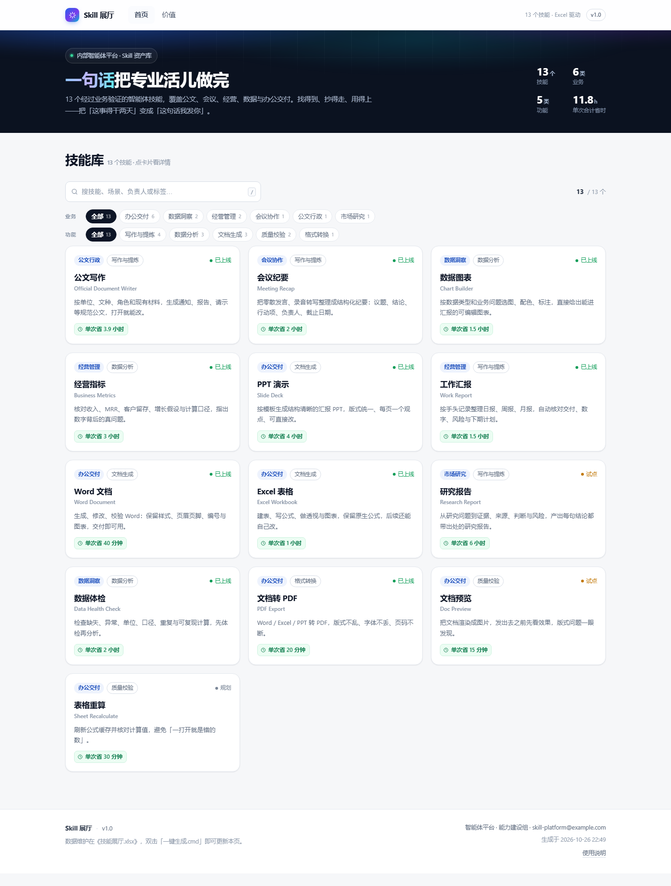
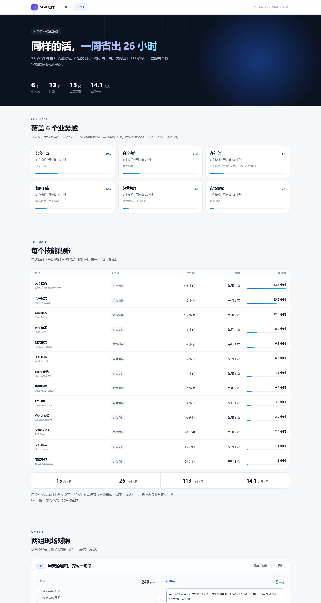

# Skill 展厅

一个离线可用的技能展示站：**Excel 维护数据 → 双击生成 → 把 `dist` 文件夹发给别人**。

- 入口：`dist/index.html`（双击打开，不需要服务器、不需要联网）
- 数据源：`技能展厅.xlsx`（唯一需要手工维护的文件）
- 生成器：`build.py` / `一键生成.cmd`
- 页面：**首页**（= 技能库）、**价值**，另有「使用指南」挂在页脚



**价值页**：先给结论（一周省出多少小时），再列覆盖的业务域、每个技能的账、合计，最后是下一步计划；末尾保留两组「以前 vs 现在」现场对照。



---

## 一、怎么更新内容

1. 打开 `技能展厅.xlsx`，改「技能清单」「价值案例」「使用指南」中的内容；
2. 双击 `一键生成.cmd`；
3. 生成成功会自动打开 `dist/index.html`，同时 `dist` 目录里的文件已更新。

脚本会做校验：必填项缺失、编号重复、耗时不是数字，都会提示到 **具体行号**，并且**不覆盖**上一次的成果（生成失败时 `dist` 保持原样）。

## 二、技能清单的字段

| 列 | 说明 |
|---|---|
| 编号 | 唯一，英文短横线 |
| 技能名称 / 一句话简介 | 卡片标题与副标题 |
| 英文名称 | 卡片的英文副标题、弹窗里的英文名（如 `Meeting Recap`），留空则不显示 |
| **业务分类** | 「哪个业务域在用」，如 公文行政 / 经营管理 / 数据洞察 |
| **功能分类** | 「这个能力干什么活」，如 写作与提炼 / 数据分析 / 文档生成 |
| **业务负责人** | 提需求、验收效果的人 |
| **IT 负责人** | 维护提示词、修问题、做迭代的人 |
| 适用场景 | 什么时候该用，写在详情抽屉 |
| 提示词示例 | 多个示例用**单独一行 `---`** 分隔，页面拆成多个复制块 |
| **单次省时(分钟)** | 纯数字。一次任务能省多少分钟，用于生成「单次省 X」标签和价值页算账 |
| **每周次数** | 纯数字，可小数（`0.25` = 每月一次）。**价值页的所有账都按它折算** |
| 提升价值 | 一句话价值，写在详情弹窗 |
| 标签 / 状态 / 推荐位 / 排序权重 | 标签参与搜索；状态三色标识；权重越大越靠前 |

业务分类和功能分类是两套独立标签，页面上是两行筛选条，交叉筛选。

## 三、价值页怎么算账

页面上的数字全部由两个字段推出来：**单次省时 × 每周次数**。

- 技能表：`每周省 = 单次省时 × 每周次数`，`每月省 = 每周省 × 4.3 周`
- 汇总：全站每周调用次数、每周/每月节省小时、折合人天（8 小时/天）
- 业务域：按技能归到业务分类，算各域占每周节省的比例

改 Excel 里这两列，价值页、首页卡片、汇总数字会一起变。耗时口径写死在页面底部，正式演讲前记得核对。

## 四、现场对照怎么配动画

价值页末尾会挑「每月节省最多」的 2 个案例做动画场景：

1. 进入视口 → 左边「以前」的步骤逐条浮现，计时器从 0 爬到传统耗时；
2. 右边「现在」的提示词以打字机方式展开，计时器瞬间跳到几分钟；
3. 底部两条耗时对比条拉出，省时比例弹出。

关键在 **传统做法用 `→` 分隔步骤**、**两个耗时列填纯数字**——动画的长短、比例都是按这两列的数值算的。每个场景右上角有「重播」，演示时可以重复播放。

## 五、目录结构

```
.
├─ 技能展厅.xlsx          ← 你要维护的数据
├─ 一键生成.cmd           ← 双击生成
├─ build.py               ← 读取 Excel + 校验 + 渲染
├─ dist/                  ← 生成结果（可整包分发，不要手改）
│  ├─ index.html          ← 统一入口
│  ├─ ui-preview.html     ← 10 套 UI 方案切换页
│  ├─ themes/             ← 方案 t01–t10 的样式
│  └─ assets/
│     ├─ style.css        ← 样式
│     ├─ app.js           ← 路由、筛选、复制、对比动画
│     └─ data.js          ← 由 Excel 生成的数据
├─ src/                   ← 模板源（改样式/结构改这里，再重新生成）
│  ├─ template.html
│  ├─ style.css
│  └─ app.js
└─ tools/make_template.py  ← 生成示例 Excel（恢复样板用，日常不需要）
```

`dist/` 每次生成会整体重建，**不要直接改 dist 里的文件**，会被覆盖。

## 六、页面与交互

- **路由**：hash 路由（`#/`、`#/story`），支持前进后退、刷新停在原页。
- **首页**：首屏压成一条紧凑横幅（数字在右侧），下面直接是技能库。搜索（`/` 键聚焦）+ 业务/功能两行筛选；卡片只保留分类、中英文名、简介和量化收益，点卡片打开**居中弹窗**。
- **弹窗**：提示词与提升价值是主角；点标题或英文名可一键复制名称；底部依次是业务标签 / 功能标签、业务与 IT 负责人。
- **价值页**：结论 → 覆盖业务域 → 每技能数据表 → 汇总 → 下一步计划 → 两组现场对照（滚动触发动画，可重播）。
- **复制**：优先 `navigator.clipboard`，`file://` 下不可用时降级 `execCommand`，都失败会提示手动复制。
- **打印**：价值页可直接 `Ctrl+P` 存 PDF，打印样式会把未播放的动画强制展开。

## 七、改风格

颜色集中在 `src/style.css` 顶部 `:root`：

- `--accent`：主色（也可只改 Excel「站点配置」里的**主题色**，重新生成会覆盖它）
- `--radius*`、`--shadow*`、`--bg` / `--surface`

字体只用系统字体（`Segoe UI` / `微软雅黑`），不引外链，保证离线一致。

## 八、分发注意

- 打包 **`dist` 整个文件夹**，对方解压后双击 `index.html`；只拷 `index.html` 会丢样式。
- 对外分享前，清掉内部联系方式、未公开业务数据、「试点」中的技能。
- 生成失败时命令行窗口里会指到行号，别急着关。

## 九、重新生成示例数据

```bat
python tools\make_template.py --force
```

会覆盖 `技能展厅.xlsx`（现有数据会丢），只在想恢复成初始 13 个技能样板时用。


## 十、UI 方案（10 套）

双击 `dist/ui-preview.html`，左下角下拉框可**实时切换** 10 套视觉方案，地址栏加 `?skin=t04` 可直接定格某一套。`dist/index.html` 保持默认方案（01 产品蓝），不受影响。

| 编号 | 方案 | 特征 | 适合 |
|---|---|---|---|
| 01 | 产品蓝 | 深色首屏 + 蓝紫渐变 + 白色卡片 | 默认，通用 |
| 02 | 编辑部 | 米白纸感、宋体标题、细线分隔、零圆角 | 汇报材料、偏正式 |
| 03 | 瑞士 | 纯白黑线、零圆角、红点强调 | 设计感强、极简 |
| 04 | 深空 | 暗色底、冷蓝光晕、玻璃卡片 | 技术评审、大屏 |
| 05 | 终端 | 等宽字体、荧光绿、硬边 | 研发团队、极客向 |
| 06 | 奶咖 | 暖白、大圆角、柔和投影 | 面向业务、亲和 |
| 07 | 玻璃 | 渐变底、磨砂卡片、紫青撞色 | 宣讲、年轻化 |
| 08 | 看板 | 浅灰底、紧凑排版、青绿强调 | 数据汇报、信息密度 |
| 09 | 宣纸 | 米色、楷体、朱红 | 国企/政务场景 |
| 10 | 粗野 | 黑白黄、粗边框、硬投影 | 强视觉冲击、海报感 |

方案文件在 `src/themes/t02.css` … `t10.css`，只覆盖 CSS 变量与关键组件，不改结构。采用某一套时，在 `src/template.html` 的 `</head>` 前加一行：

```html
<link rel="stylesheet" href="themes/t04.css">
```

再把主题文件一起拷进 `dist/themes/` 即可（`build.py` 已自动拷贝）。
